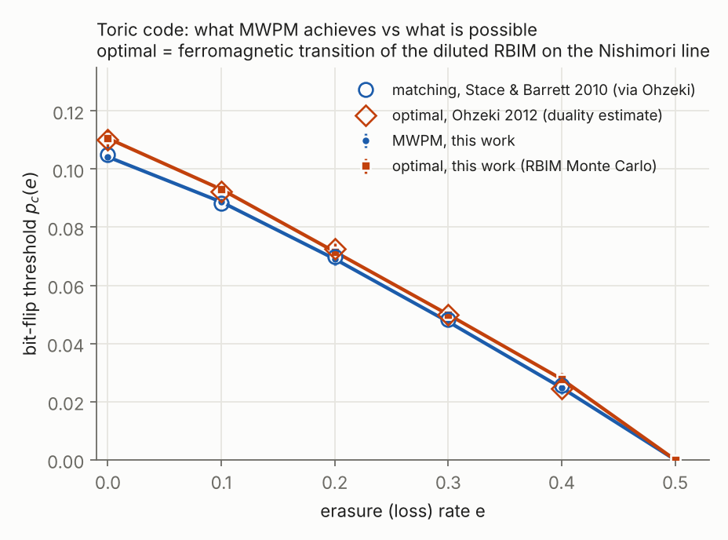
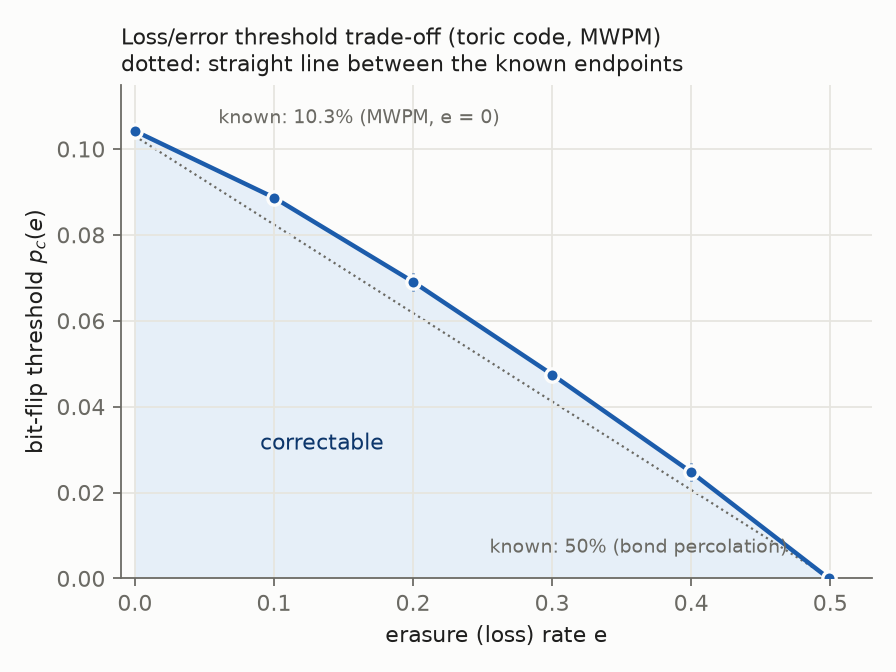
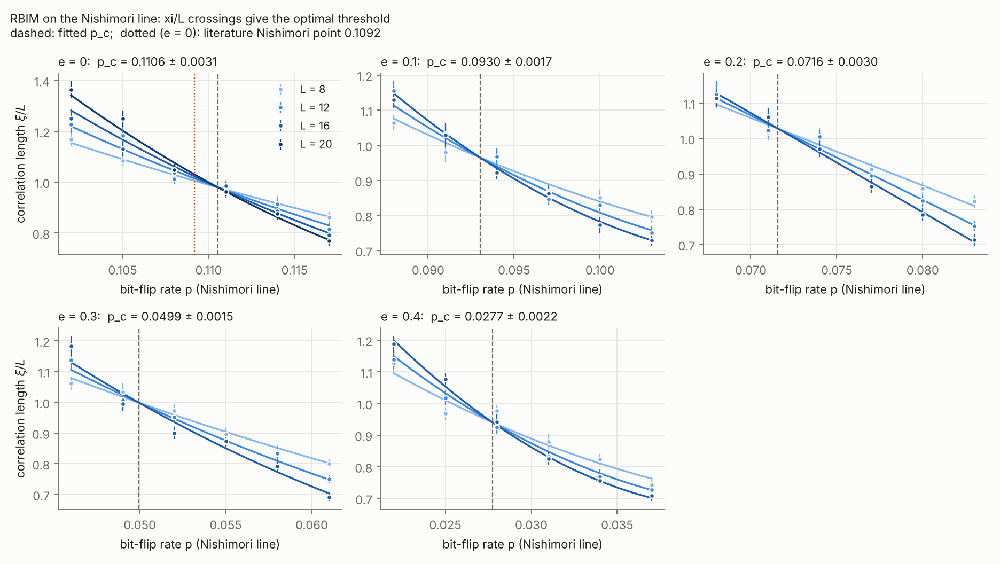

# lossy-toric-codes

[](https://github.com/louis-spatscheck/lossy-toric-codes/actions/workflows/tests.yml)

Thresholds of the toric code under **bit-flip errors plus erasures** (heralded photon loss),
computed in two independent ways:

* **Phase 1, decoder:** what minimum-weight perfect matching (MWPM) achieves, by direct simulation.
* **Phase 2a, optimal:** what any decoder could achieve at best, from the stat-mech mapping to the
  random-bond Ising model (RBIM) on the Nishimori line, by Monte Carlo with parallel tempering.

Thresholds are extracted by finite-size scaling (FSS).

**Status.** Every number below reproduces a published value within errors, for the matching decoder and
for the optimal one. That makes it a tested baseline for the next step: qudit $\mathbb{Z}_d$ codes, where
the loss/error trade-off is much less mapped out (see *Roadmap*).



## Phase 1: MWPM thresholds

Code-capacity noise on an $L\times L$ torus: each qubit is erased with probability $e$
(and then fully depolarised, so it carries an X error with probability 1/2, at a known
location). Each non-erased qubit gets an X error with probability $p$. MWPM uses edge weight 0
on erased qubits and 1 elsewhere. System sizes are $L = 8, 12, 16, 24$, with $10^4$–$4\times10^4$ shots per point.

| noise | threshold (this work) | known value | FSS exponent $\nu$ |
|---|---|---|---|
| bit-flip only ($e=0$) | $p_c = 0.1042 \pm 0.0002_{\rm stat} \pm 0.0008_{\rm sys}$ | 0.103 (MWPM) [2] | $1.53 \pm 0.04$ |
| $e = 0.1$ | $p_c = 0.0887 \pm 0.0003 \pm 0.0013$ | | $1.38 \pm 0.08$ |
| $e = 0.2$ | $p_c = 0.0691 \pm 0.0003 \pm 0.0021$ | | $1.54 \pm 0.10$ |
| $e = 0.3$ | $p_c = 0.0475 \pm 0.0003 \pm 0.0012$ | | $1.60 \pm 0.11$ |
| $e = 0.4$ | $p_c = 0.0247 \pm 0.0003 \pm 0.0021$ | | $1.65 \pm 0.09$ |
| erasure only ($p=0$) | $e_c = 0.4989 \pm 0.0009 \pm 0.0013$ | 1/2 (bond percolation) [3] | $1.33 \pm 0.07$ (percolation: 4/3) |

* **Validation.** Both endpoints agree with the literature. For erasure only, the fitted
  exponent $\nu = 1.33 \pm 0.07$ is consistent with the 2D percolation value $4/3$, but it depends on
  the fit window (see *Limitations*), so treat it as a consistency check. The reason to expect
  percolation: with erasures only, the decoder can only fail when the erased qubits contain a loop around the torus.
  The bit-flip value sits about 1.5σ (combined error) above 10.3%. The pairwise crossings
  of consecutive sizes range from 0.1024 to 0.1041, so the remaining offset is consistent with
  finite-size corrections at $L \le 24$.
* **Trade-off.** $p_c(e)$ decreases smoothly from 10.4% to 0 at $e = 1/2$. It lies slightly
  above the straight line between the two endpoints. Erasure is much cheaper to correct than
  unknown errors, which is why heralded loss is the "good" error for photonics.
* **Error bars.** Statistical errors come from a parametric bootstrap of the FSS fit (half the 16–84%
  range of the refitted values). The systematic
  error is half the spread of pairwise crossings of consecutive $L$, a crude estimate of the
  finite-size corrections that the quadratic ansatz $P_L = A + Bx + Cx^2$,
  $x = (q-q_c)L^{1/\nu}$, ignores.




### Limitations of Phase 1

* **Code capacity**: perfect syndrome measurements. No measurement errors and no circuit-level noise.
* **MWPM is not optimal.** The optimal (maximum-likelihood) threshold is higher; Phase 2a computes it.
* Independent X/Z noise, so one sector is simulated. A toric rather than a planar geometry.
* The erasure-only fit uses a window of ±0.025 around a first-pass estimate. Over the full ±0.06 sweep
  the quadratic ansatz fails (χ²/dof ≈ 37).
* Erasure decoding rebuilds the matching graph every shot (1–5 ms/shot at these sizes). PyMatching
  has no per-shot weight API. A union-find decoder would remove this cost.

## Phase 2a: optimal thresholds from the stat-mech mapping

**Mapping** [1]. Put Ising spins on the dual lattice, one bond per qubit. A bit flip makes its bond
antiferromagnetic ($J=-1$). An erased qubit carries a uniformly random flip, i.e. no information, so its
bond is removed ($J=0$, dilution) [4,5]. The temperature is not a free parameter: Bayes-optimal
decoding puts the model on the **Nishimori line** [11], $\tanh\beta = 1-2p$. The optimal decoder
succeeds for large $L$ exactly when this disordered magnet is ferromagnetically ordered, so the optimal
threshold $p_c(e)$ is the ferro/para transition along the Nishimori line.

**Method.** Monte Carlo of $10^3$ disorder samples per point, for $L = 8$–$20$ ($e = 0$) and $L = 8$–$16$
($e > 0$). Checkerboard heat bath plus parallel tempering [12] (8 temperatures from $\beta_N$ to
$\beta = 0.6$), vectorised over samples and temperatures in numpy. Observable: the second-moment
correlation length $\xi/L$, which is scale invariant at the transition, so curves for different $L$ cross at
$p_c$. Errors are jackknifed over disorder samples, then fitted with the same FSS ansatz as Phase 1.

| erasure $e$ | optimal $p_c$ (this work) | optimal, Ohzeki 2012 [10] | MWPM (Phase 1) | matching, Stace & Barrett [4] (via [10]) |
|---|---|---|---|---|
| 0   | $0.1106 \pm 0.0008 \pm 0.0030$ | 0.1100 (precise MC: 0.1092 [13]) | 0.1042 | 0.1049 |
| 0.1 | $0.0930 \pm 0.0013 \pm 0.0011$ | 0.0924 | 0.0887 | 0.0882 |
| 0.2 | $0.0716 \pm 0.0018 \pm 0.0024$ | 0.0725 | 0.0691 | 0.0700 |
| 0.3 | $0.0499 \pm 0.0015 \pm 0.0000^{*}$ | 0.0498 | 0.0475 | 0.0484 |
| 0.4 | $0.0277 \pm 0.0011 \pm 0.0019$ | 0.0246 | 0.0247 | 0.0256 |

Ohzeki's values are read from Table I of [10]; check the table for the approximation level before quoting them.

$^{*}$ With three sizes there are only two pairwise crossings; at $e=0.3$ they coincide by chance,
so the systematic error is underestimated there.

* **Agreement.** Every optimal value agrees with Ohzeki's duality estimates [10] within errors, and
  $e=0$ agrees with the high-precision Nishimori point $p_c = 0.10919(7)$ [13] at 0.5σ. Optimal lies
  above MWPM at every $e$, by about 0.003–0.006: MWPM is close to optimal for this code and noise.
  Whether that stays true for qudits, where matching is no longer exact, is the first question for $\mathbb{Z}_3$.
* **One detail at $e = 0.4$.** The duality estimate (0.0246) lies *below* the matching value (0.0256),
  which an optimal threshold cannot do; the duality method is an approximation, and [10] notes
  finite-size effects from lost qubits at large loss. Our Monte Carlo keeps the correct ordering
  (0.0277 > 0.0247), although it is only 1.4σ from 0.0246, so this is a consistency check, not a claim.
* **Exact checks.** (i) Brute-force enumeration of all $2^{16}$ states of a 4×4 lattice with frustrated
  and diluted couplings. (ii) The Nishimori energy identity $[\langle\sum_b J_b s_i s_j\rangle] =
  N_b(1-e)(1-2p)$ holds at all 96 grid points (z-scores: mean 0.3, standard deviation 0.9).
  (iii) Equilibration: a planted (all-up) start over-estimates $\xi/L$ until the chain decorrelates, a
  random start under-estimates it; the two agree within errors at every $L$ and $e$ used
  (`scripts/rbim_eqcheck.py`).



### What did not work (and why the sizes stop at 16–20)

* **Single-spin updates alone:** at $L=12$ near $p_c$ the planted and random starts still disagree
  after $10^4$ sweeps. Disorder pins domain walls, so equilibration is very slow.
* **Swendsen–Wang cluster moves:** valid for frustrated couplings but hardly faster here; the clusters
  span the system in the ordered phase.
* **Parallel tempering** fixes it, but the time to equilibrate grows steeply with $L$: $L=20$ needs
  about 1500 sweeps; $L=24$ was still not equilibrated after 1000 and would need about 3000. With 2 CPU
  cores, the run stops at $L = 20$. That limits precision ($\pm 0.003$ vs $\pm 0.0001$ in [13]) and
  leaves finite-size corrections visible in the scatter of pairwise crossings.
* The **planted start is not a free equilibration** for the magnetisation (a mistake in my first
  version): it is an exact equilibrium sample only for gauge-invariant observables such as the energy.

## Roadmap

1. ~~Optimal qubit thresholds via the RBIM on the Nishimori line, with dilution~~ (done, Phase 2a).
2. **Domain-wall free energy.** The optimal decoder's failure probability is set by ratios of
   partition functions with twisted boundary conditions, a free-energy-difference estimation
   problem (variance reduction, signal-to-noise). It gives a decoder-level observable directly
   comparable to Phase 1.
3. **$\mathbb{Z}_3$ (qutrit) toric code** with erasure. A self-written decoder (PyMatching is qubit-only).
4. **Diluted random 3-state Potts/clock model** → optimal loss/error trade-off for qutrits.
   Stay at $d \le 4$: for $d \ge 5$ the clean clock model has BKT transitions.
5. *Optional:* $\mathbb{Z}_4$ vs $\mathbb{Z}_2\times\mathbb{Z}_2$ (same local dimension, different group):
   a first look at group dependence. Group surface codes, the quantum double models of finite groups,
   give non-Clifford gates for the qubit surface code [14]; how much loss they tolerate is open territory
   for this kind of pipeline.

First steps towards item 3 (pure erasure for $d = 2, 3$, lattice and stubs) are in `wip/zd/`; not yet tested like `src/`.

Prior work this builds on (so nothing gets reinvented): qubit loss + error thresholds [3,4];
exact stat-mech mappings with erasure + computational errors for qubits [5]; qudit toric-code
decoders and thresholds without erasure [6,7]; random-bond clock models for decohered
$\mathbb{Z}_N$ toric codes [8].

## Run it

Needs Python ≥ 3.10 and about 300 MB of free disk for the virtual environment. No GPU.

Linux / macOS:

```bash
python -m venv .venv && source .venv/bin/activate
pip install --no-cache-dir -e ".[test]"
pytest                                            # 23 tests, ~15 s
python scripts/analyze.py                         # refit included data, redraw figures
```

Windows (cmd):

```bat
python -m venv .venv
.venv\Scripts\activate
pip install --no-cache-dir -e ".[test]"
pytest
```

(PowerShell: `.venv\Scripts\Activate.ps1`.) `--no-cache-dir` avoids filling pip's download cache on small disks.

Reproduce the data (about 15 min on 2 cores in total; erasure sweeps dominate):

```bash
L="8 12 16 24"
python scripts/sweep.py --L $L --p 0.095 0.110 7 --e 0   --shots 40000 --out data/fine.csv
python scripts/sweep.py --L $L --p 0.080 0.095 7 --e 0.1 --shots 10000 --out data/fine.csv
python scripts/sweep.py --L $L --p 0.058 0.073 7 --e 0.2 --shots 10000 --out data/fine.csv
python scripts/sweep.py --L $L --p 0.038 0.053 7 --e 0.3 --shots 10000 --out data/fine.csv
python scripts/sweep.py --L $L --p 0.012 0.027 7 --e 0.4 --shots 10000 --out data/fine.csv
python scripts/sweep.py --L $L --p 0 --e 0.44 0.56 7    --shots 10000 --out data/erasure_only.csv
python scripts/analyze.py
```

Phase 2a (about 25 min for $e=0$ and 35 min for the four erasure rates, on 2 cores):

```bash
python scripts/rbim_eqcheck.py --L 16 --p 0.108 --e 0     # planted vs random start must agree
python scripts/rbim_sweep.py --L 8 12 16 20 --p 0.102 0.117 6 --e 0 --samples 1000
python scripts/rbim_sweep.py --L 8 12 16 --p 0.088 0.103 6 --e 0.1 --samples 1000   # etc. for e = 0.2-0.4
python scripts/rbim_analyze.py
```

Per-sample results (one file per chunk of 250 disorder samples) are in `data/rbim/*.npz`, so
`rbim_analyze.py` runs without re-simulating; fitted thresholds are in `results/rbim_thresholds.csv`.

Rows are appended, so re-running with `--seed 1` adds statistics. Move the old CSVs away
first for a clean reproduction. `data/coarse.csv` is the initial coarse scan used to place
the fine windows.

## Layout

```
src/lossytoric/
  toric.py      lattice, check matrix H, logical operators (conventions in the docstring)
  noise.py      bit-flip + erasure sampling
  decoder.py    PyMatching MWPM with erasure weights
  simulate.py   Monte Carlo of the logical failure rate (Wilson intervals)
  fss.py        finite-size-scaling fit, bootstrap errors, pairwise crossings
  rbim.py       random-bond Ising model on the Nishimori line: heat bath + parallel tempering, jackknife
scripts/        sweep.py, analyze.py                      (Phase 1: MWPM)
                rbim_sweep.py, rbim_eqcheck.py, rbim_analyze.py   (Phase 2a: stat-mech MC)
tests/          lattice algebra, decoder sanity, erasure use, FSS fit on synthetic data,
                RBIM vs exact enumeration, Nishimori identity, planted vs random start
data/ results/ figures/
```

## References

1. E. Dennis, A. Kitaev, A. Landahl, J. Preskill, *Topological quantum memory*, J. Math. Phys. 43, 4452 (2002).
2. C. Wang, J. Harrington, J. Preskill, *Confinement-Higgs transition in a disordered gauge theory and the accuracy threshold for quantum memory*, Ann. Phys. 303, 31 (2003).
3. T. M. Stace, S. D. Barrett, A. C. Doherty, *Thresholds for topological codes in the presence of loss*, PRL 102, 200501 (2009).
4. T. M. Stace, S. D. Barrett, *Error correction and degeneracy in surface codes suffering loss*, PRA 81, 022317 (2010).
5. L. Colmenarez, S. Kim, M. Müller, *Fundamental thresholds for computational and erasure errors via the coherent information*, PRX Quantum 6, 040327 (2025).
6. G. Duclos-Cianci, D. Poulin, *Kitaev's Z_d-codes threshold estimates*, arXiv:1302.3638.
7. H. Anwar, B. J. Brown, E. T. Campbell, D. E. Browne, *Fast decoders for qudit topological codes*, NJP 16, 063038 (2014).
8. A. Vijay, J. Y. Lee, *Information critical phases under decoherence*, arXiv:2512.22121.
9. O. Higgott, C. Gidney, *Sparse Blossom: correcting a million errors per core second with minimum-weight matching* (PyMatching v2), Quantum 9, 1600 (2025).
10. M. Ohzeki, *Error threshold estimates for surface code with loss of qubits*, PRA 85, 060301(R) (2012).
11. H. Nishimori, *Internal energy, specific heat and correlation function of the bond-random Ising model*, Prog. Theor. Phys. 66, 1169 (1981).
12. K. Hukushima, K. Nemoto, *Exchange Monte Carlo method and application to spin glass simulations*, J. Phys. Soc. Jpn. 65, 1604 (1996).
13. M. Hasenbusch, F. Parisen Toldin, A. Pelissetto, E. Vicari, *Multicritical Nishimori point in the phase diagram of the ±J Ising model on a square lattice*, PRE 77, 051115 (2008).
14. N. Manjunath, V. Mattei, A. Tiwari, T. D. Ellison, *Universal quantum computation with group surface codes*, arXiv:2603.05502 (2026).

## How this was made

The code and text in this repository were written with substantial help from an AI assistant (Claude).

## Licence

MIT. Questions or corrections are welcome: open an issue or email louisspatscheck@gmail.com.
