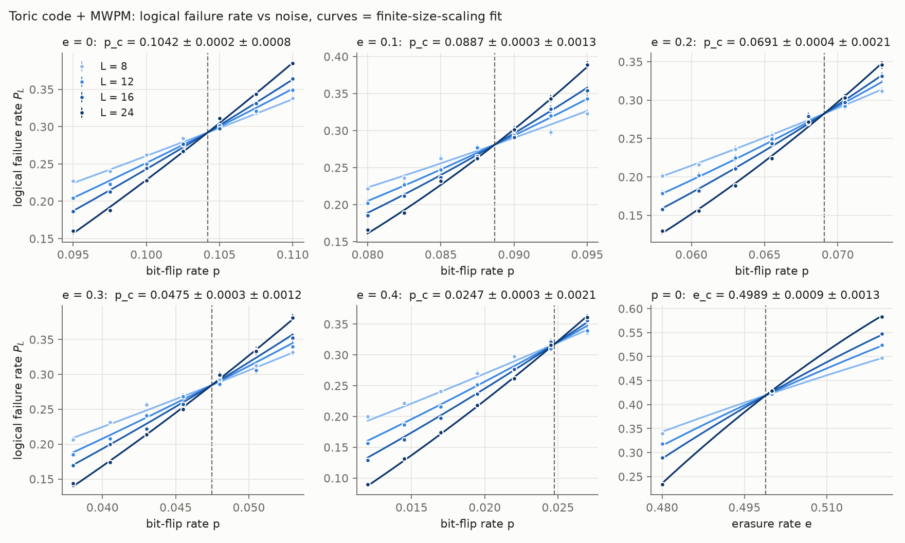

# lossy-toric-codes

Thresholds of the toric code under **bit-flip errors plus erasures** (heralded photon loss),
decoded with minimum-weight perfect matching (MWPM). Thresholds are extracted by
finite-size scaling (FSS).

**Status: Phase 1, a reproduction of known results.** Nothing in this phase is new. The
point is a tested, validated pipeline that the next phase (qudit $\mathbb{Z}_d$ codes and
optimal thresholds from disordered spin models, see *Roadmap*) builds on.


## Results

Code-capacity noise on an $L\times L$ torus: each qubit is erased with probability $e$
(and then fully depolarised, so it carries an X error with probability 1/2, at a known
location). Each non-erased qubit gets an X error with probability $p$. MWPM uses edge weight 0
on erased qubits and 1 elsewhere. System sizes are $L = 8, 12, 16, 24$, with $10^4$–$4\times10^4$ shots per point.

| noise | threshold (this work) | known value | FSS exponent $\nu$ |
|---|---|---|---|
| bit-flip only ($e=0$) | $p_c = 0.1042 \pm 0.0002_{\rm stat} \pm 0.0008_{\rm sys}$ | 0.103 (MWPM) [2] | $1.53 \pm 0.04$ |
| $e = 0.1$ | $p_c = 0.0887 \pm 0.0003 \pm 0.0013$ | | $1.38 \pm 0.08$ |
| $e = 0.2$ | $p_c = 0.0691 \pm 0.0004 \pm 0.0021$ | | $1.54 \pm 0.10$ |
| $e = 0.3$ | $p_c = 0.0475 \pm 0.0003 \pm 0.0012$ | | $1.60 \pm 0.10$ |
| $e = 0.4$ | $p_c = 0.0247 \pm 0.0003 \pm 0.0021$ | | $1.65 \pm 0.09$ |
| erasure only ($p=0$) | $e_c = 0.4989 \pm 0.0009 \pm 0.0013$ | 1/2 (bond percolation) [3] | $1.33 \pm 0.07$ (percolation: 4/3) |

* **Validation.** Both endpoints agree with the literature. For erasure only, the fitted
  exponent $\nu = 1.33 \pm 0.07$ also matches the exact 2D percolation value $4/3$. That is an
  independent check: the decoder fails exactly when erased qubits percolate around the torus.
  The bit-flip value sits about 1.5σ (combined error) above 10.3%. The pairwise crossings
  of consecutive sizes range from 0.1024 to 0.1041, so the remaining offset is consistent with
  finite-size corrections at $L \le 24$.
* **Trade-off.** $p_c(e)$ decreases smoothly from 10.4% to 0 at $e = 1/2$. It lies slightly
  above the straight line between the two endpoints. Erasure is much cheaper to correct than
  unknown errors, which is why heralded loss is the "good" error for photonics.
* **Error bars.** Statistical errors come from a parametric bootstrap of the FSS fit. The systematic
  error is half the spread of pairwise crossings of consecutive $L$, a crude estimate of the
  finite-size corrections that the quadratic ansatz $P_L = A + Bx + Cx^2$,
  $x = (q-q_c)L^{1/\nu}$, ignores.



## Limitations (on purpose, for Phase 1)

* **Code capacity**: perfect syndrome measurements. No measurement errors and no circuit-level noise.
* **MWPM is not optimal.** The optimal (maximum-likelihood) threshold for bit flips is about 10.9%,
  set by the Nishimori point of the random-bond Ising model [1]. Phase 2 computes the optimal
  side directly.
* Independent X/Z noise, so one sector is simulated. A toric rather than a planar geometry.
* The erasure-only fit uses a window of ±0.025 around a first-pass estimate. Over the full ±0.06 sweep
  the quadratic ansatz fails (χ²/dof ≈ 37).
* Erasure decoding rebuilds the matching graph every shot (1–5 ms/shot at these sizes). PyMatching
  has no per-shot weight API. A union-find decoder would remove this cost.

## Roadmap (Phase 2)

1. **$\mathbb{Z}_3$ (qutrit) toric code** with erasure. A self-written decoder (PyMatching is qubit-only).
2. **Optimal thresholds via stat-mech.** Monte Carlo of the random-bond Ising model on the Nishimori line
   (target: $p_c \approx 0.109$). Erasure enters as bond dilution. The domain-wall free energy is a
   ratio of partition functions, i.e. a free-energy-difference estimation problem. Validate the
   qubit optimal loss/error curve against the analytical estimates of [10] and the mapping of [5].
3. **Diluted random 3-state Potts/clock model** → optimal loss/error trade-off for qutrits.
   Stay at $d \le 4$: for $d \ge 5$ the clean clock model has BKT transitions.
4. *Optional:* $\mathbb{Z}_4$ vs $\mathbb{Z}_2\times\mathbb{Z}_2$ (same local dimension, different group):
   a first look at group dependence, in the spirit of group surface codes / quantum doubles.

Prior work this builds on (so nothing gets reinvented): qubit loss + error thresholds [3,4];
exact stat-mech mappings with erasure + computational errors for qubits [5]; qudit toric-code
decoders and thresholds without erasure [6,7]; random-bond clock models for decohered
$\mathbb{Z}_N$ toric codes [8].

## Run it

Needs Python ≥ 3.10 and about 270 MB of disk for the virtual environment. No GPU.

```bash
python -m venv .venv && source .venv/bin/activate      # Windows: .venv\Scripts\activate
pip install -e ".[test]"
pytest                                                  # 15 tests, < 2 s
python scripts/analyze.py                               # refit the included data, redraw figures
```

Reproduce the data (about 15 min on 2 cores in total; erasure sweeps dominate):

```bash
L="8 12 16 24"
python scripts/sweep.py --L $L --p 0.095 0.110 7 --e 0   --shots 40000 --out data/fine.csv
python scripts/sweep.py --L $L --p 0.080 0.095 7 --e 0.1 --shots 10000 --out data/fine.csv
python scripts/sweep.py --L $L --p 0.058 0.073 7 --e 0.2 --shots 10000 --out data/fine.csv
python scripts/sweep.py --L $L --p 0.038 0.053 7 --e 0.3 --shots 10000 --out data/fine.csv
python scripts/sweep.py --L $L --p 0.012 0.027 7 --e 0.4 --shots 10000 --out data/fine.csv
python scripts/sweep.py --L $L --p 0 --e 0.44 0.56 7    --shots 10000 --out data/erasure_only.csv
python scripts/analyze.py
```

Rows are appended, so re-running with `--seed 1` adds statistics. Move the old CSVs away
first for a clean reproduction. `data/coarse.csv` is the initial coarse scan used to place
the fine windows.

## Layout

```
src/lossytoric/
  toric.py      lattice, check matrix H, logical operators (conventions in the docstring)
  noise.py      bit-flip + erasure sampling
  decoder.py    PyMatching MWPM with erasure weights
  simulate.py   Monte Carlo of the logical failure rate (Wilson intervals)
  fss.py        finite-size-scaling fit, bootstrap errors, pairwise crossings
scripts/        sweep.py (parallel grid -> CSV), analyze.py (fits + figures)
tests/          lattice algebra, decoder sanity, erasure use, FSS fit on synthetic data
data/ results/ figures/
```

## References

1. E. Dennis, A. Kitaev, A. Landahl, J. Preskill, *Topological quantum memory*, J. Math. Phys. 43, 4452 (2002).
2. C. Wang, J. Harrington, J. Preskill, *Confinement-Higgs transition in a disordered gauge theory and the accuracy threshold for quantum memory*, Ann. Phys. 303, 31 (2003).
3. T. M. Stace, S. D. Barrett, A. C. Doherty, *Thresholds for topological codes in the presence of loss*, PRL 102, 200501 (2009).
4. T. M. Stace, S. D. Barrett, *Error correction and degeneracy in surface codes suffering loss*, PRA 81, 022317 (2010).
5. L. Colmenarez, S. Kim, M. Müller, *Fundamental thresholds for computational and erasure errors via the coherent information*, PRX Quantum 6, 040327 (2025).
6. G. Duclos-Cianci, D. Poulin, *Kitaev's Z_d-codes threshold estimates*, arXiv:1302.3638.
7. H. Anwar, B. J. Brown, E. T. Campbell, D. E. Browne, *Fast decoders for qudit topological codes*, NJP 16, 063038 (2014).
8. A. Vijay, J. Y. Lee, *Information critical phases under decoherence*, arXiv:2512.22121.
9. O. Higgott, C. Gidney, *Sparse Blossom: correcting a million errors per core second with minimum-weight matching* (PyMatching v2), Quantum 9, 1600 (2025).
10. M. Ohzeki, *Error threshold estimates for surface code with loss of qubits*, PRA 85, 060301(R) (2012).
